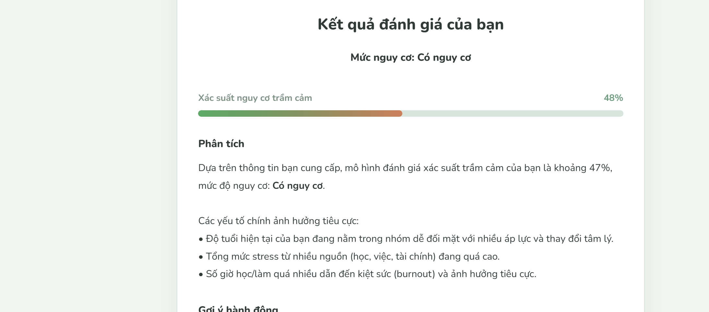
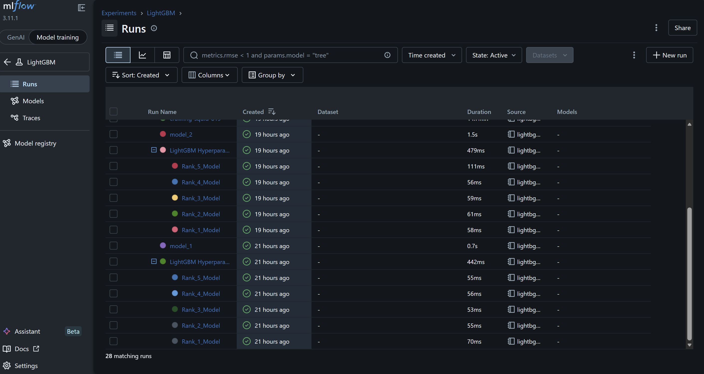

# Student Depression Prediction App

## Overview
The **Student Depression Prediction App** is an end-to-end Machine Learning project designed to predict the risk of depression among university students based on academic, psychological, and demographic factors. Built with **FastAPI** and a powerful **Stacking Ensemble**, this application provides a robust and scalable backend for real-time inference, coupled with **SHAP** for model interpretability.

## Key Features
- **Predictive Analytics**: High-accuracy Stacking Classifier combining Random Forest, XGBoost, and LightGBM for superior predictive performance.
- **Model Explainability**: Integration with SHAP to translate black-box model predictions into actionable, human-readable insights for each individual prediction.
- **RESTful API**: Fast and fully documented API via FastAPI and Swagger UI.
- **Modular Data Pipeline**: Highly reusable Pandas-based preprocessing steps (cleaning, imputation, standardization, feature engineering).
- **Extensible Architecture**: Clean code following modern Python standards (`argparse`, structured logging, type checking).

## Evaluation Results

| Metric | Holdout test (%) | 5-fold CV mean ± std (%) |
| --- | ---: | ---: |
| Accuracy | 83.84 | 84.21 ± 0.33 |
| Precision | 85.02 | 85.34 ± 0.49 |
| Recall | 87.88 | 88.19 ± 0.30 |
| F1-score | 86.43 | 86.74 ± 0.25 |

See [model/README.md](model/README.md) for detailed results and evaluation settings.

## Architecture & Tech Stack
- **Backend Framework**: FastAPI, Pydantic, Uvicorn (ASGI)
- **Machine Learning**: Scikit-Learn (Stacking Classifier, Random Forest, Logistic Regression), XGBoost, LightGBM
- **Model Explainability**: SHAP
- **Data Engineering & Visualization**: Pandas, NumPy, Matplotlib, Seaborn
- **Experiment Tracking**: MLflow with SQLite storage
- **Persistence**: Joblib
- **Frontend**: HTML, CSS, JavaScript
- **Deployment**: Docker, Docker Compose
- **Testing**: Pytest

## Directory Structure
```text
.
├── api/
│   └── main.py                 # FastAPI application entry point and routes
├── data/
│   ├── README.md               # Dataset download and preprocessing instructions
│   ├── raw/                    # Raw CSV data (ignored by Git)
│   └── processed/              # Generated processed CSV data (ignored by Git)
├── docs/
│   └── images/                 # Application and MLflow screenshots
├── model/
│   ├── README.md               # Description of the generated model artifacts
│   ├── model.pkl               # Trained classifier (ignored by Git)
│   ├── explainer.pkl           # SHAP explainer (ignored by Git)
│   ├── feature_names.pkl       # Ordered feature names (ignored by Git)
│   └── reports/                # Selected evaluation reports (versioned)
│       └── <run_id>/            # Metrics, CV scores, confusion matrix, metadata
├── notebook/                  # Exploration notebooks and experiment notes
├── src/
│   ├── pipelines/
│   │   ├── preprocessing.py    # Data cleaning, encoding, and feature engineering
│   │   ├── train.py            # Model configuration and training
│   │   ├── evaluate.py         # Holdout and cross-validation evaluation
│   │   ├── save.py             # Artifact serialization
│   │   └── pipeline.py         # Training workflow and MLflow tracking
│   └── deploy/
│       ├── predict.py          # Inference and SHAP calculations
│       ├── schemas.py          # API input and response schemas
│       └── logic_translator.py # Vietnamese explanations and recommendations
├── static/                    # Web interface (HTML, CSS, JavaScript)
├── tests/
│   └── test_model.py           # Data/model artifact checks and API integration test
├── .gitignore                 # Git exclusions for local and generated files
├── .dockerignore              # Docker build context exclusions
├── Dockerfile                 # API container image definition
├── docker-compose.yml         # Local container configuration
├── Makefile                   # Development commands
├── requirements.txt           # Python dependencies
├── LICENSE
└── README.md
```

See [data/README.md](data/README.md) for dataset preparation and
[model/README.md](model/README.md) for the generated artifact descriptions.

## Setup & Installation

### Prerequisites

- Python 3.10+
- Git
- GNU Make (optional, for the `make` commands below)
- Docker with Docker Compose (optional, for running the application in a container)

### 1. Clone the Repository

```bash
git clone https://github.com/nguyenlionelv/student-depression-prediction.git
cd student-depression-prediction
```

Run the following commands from the repository root.

### 2. Create and Activate a Virtual Environment

```bash
python -m venv .venv
```

On Windows (PowerShell):

```powershell
.\.venv\Scripts\Activate.ps1
```

On macOS/Linux:

```bash
source .venv/bin/activate
```

Keep the virtual environment activated for the remaining Python commands.

### 3. Install Dependencies

Install the project dependencies and MLflow for experiment tracking:

```bash
python -m pip install -r requirements.txt
python -m pip install mlflow
```

If GNU Make is installed, `make install` can replace the first command.

### 4. Prepare the Dataset

Follow [data/README.md](data/README.md) to download the dataset and place the raw
CSV at:

```text
data/raw/student_depression_dataset.csv
```

The training pipeline generates the processed CSV when it does not exist.
Instructions for preprocessing separately or regenerating an existing processed
CSV are also available in the data README. Dataset files are stored locally and
are not included when cloning the repository.

### 5. Model Training Pipeline

Train the model before starting the API:

```bash
python src/pipelines/pipeline.py
```

Or, with GNU Make:

```bash
make train
```

The pipeline preprocesses the data or reuses the existing processed CSV, trains
the Stacking Classifier, evaluates it, and records cross-validation metrics in
MLflow using the local `mlflow.db` database.

Upon successful completion, `model.pkl`, `explainer.pkl`, and `feature_names.pkl`
are saved in `model/`, replacing existing files with the same names. See
[model/README.md](model/README.md) for the artifact descriptions. Training the
ensemble, running cross-validation, and creating the SHAP explainer can take time.

### 6. Running the API Server

Start the API and frontend locally:

```bash
python -m uvicorn api.main:app --host 127.0.0.1 --port 8000 --reload
```

Or, with GNU Make:

```bash
make run
```

To also launch the frontend Web UI in your default browser, use:

```bash
make deploy
```

- **Web Interface:** Access the frontend application at [http://localhost:8000](http://localhost:8000)
- **API Documentation Sandbox:** Visit the auto-generated Swagger UI at [http://localhost:8000/docs](http://localhost:8000/docs)
- **Production Web (Render):** https://student-depression-predictation.onrender.com

### 7. Running via Docker

After preparing the dataset and training the model, you can run the API and
frontend with Docker Compose. Ensure all three model artifacts described in
[model/README.md](model/README.md) are present in `model/` before building.

The Docker image uses these local artifacts and skips training when
`model/model.pkl` exists.

**Start the application:**

```bash
docker-compose up --build -d
```

Once the container starts, open [http://localhost:8000](http://localhost:8000).

**Stop the application:**

```bash
docker-compose down
```

## Application Preview



## REST API Endpoints

| Method | Endpoint | Description |
|--------|----------|-------------|
| `GET` | `/` | Serves the main landing page UI. |
| `GET` | `/survey` | Serves the interactive student survey frontend. |
| `GET` | `/health` | API health check endpoint. |
| `POST`| `/predict`| Accepts a student profile (JSON payload) and returns depression prediction, risk level, and SHAP-based interpretations. |

### Example Request (`POST /predict`)
```json
{
  "gender": "Female",
  "age": 21,
  "academic_pressure": 4,
  "work_pressure": 2,
  "cgpa": 7.5,
  "study_satisfaction": 2,
  "job_satisfaction": 1,
  "sleep_duration": "5-6 hours",
  "dietary_habits": "Unhealthy",
  "degree": "B.Tech",
  "suicidal_thoughts": "No",
  "work_study_hours": 8,
  "financial_stress": 4,
  "family_history": "No"
}
```

## Notebook Experiments with MLflow

The notebooks in [notebook/](notebook/) record model experiments in MLflow.
Use the MLflow UI to inspect run metrics, parameters, and logged figures, and
compare results across experiments.

With your Python environment activated and MLflow installed, run the following
command from the repository root to open the notebook tracking database:

```bash
mlflow ui --backend-store-uri sqlite:///notebook/mlflow.db --port 5000
```

Open [http://localhost:5000](http://localhost:5000), select an experiment and a run,
then browse its **Model metrics** and **Artifacts** tabs. The notebook experiment
history is stored locally in `notebook/mlflow.db` and `notebook/mlruns/`, which are
ignored by Git. On a fresh clone, run the notebook experiment cells from the
`notebook/` working directory to generate this history.



*LightGBM notebook experiment history in MLflow, including hyperparameter search runs. The evaluation table above
summarizes the selected Stacking Ensemble run.*

## Author

**Bui Trong Nguyen** · [GitHub](https://github.com/nguyenlionelv)
